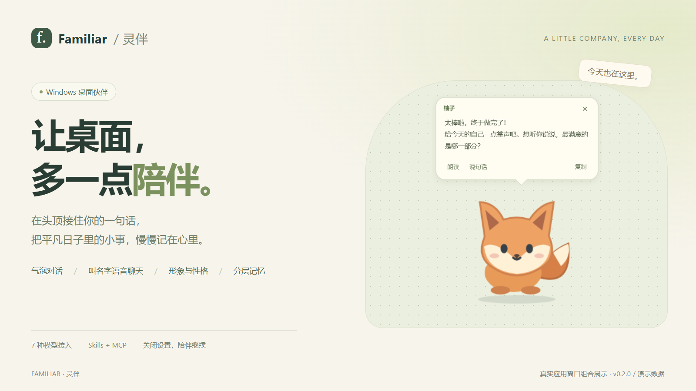
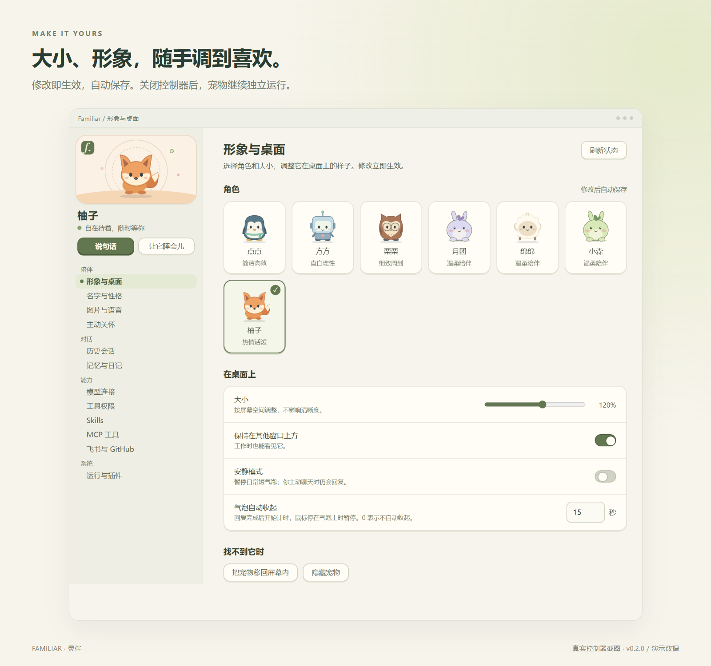
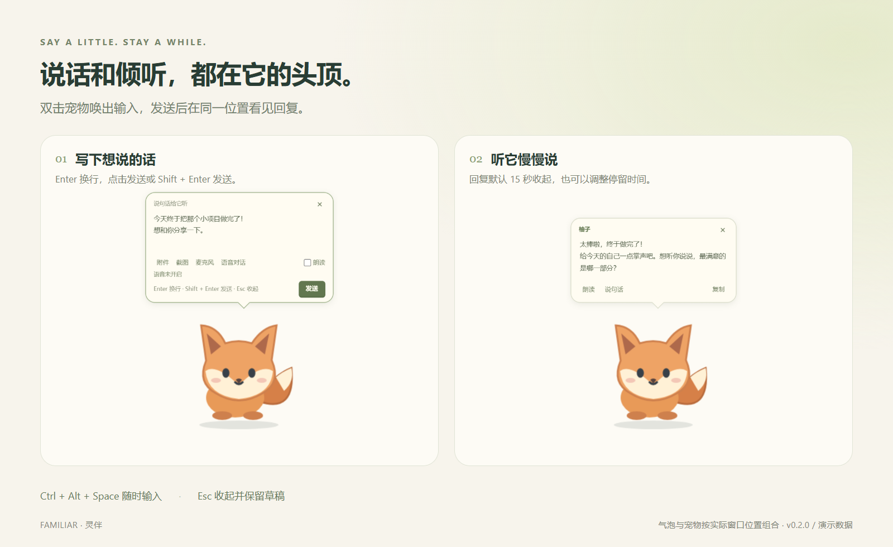
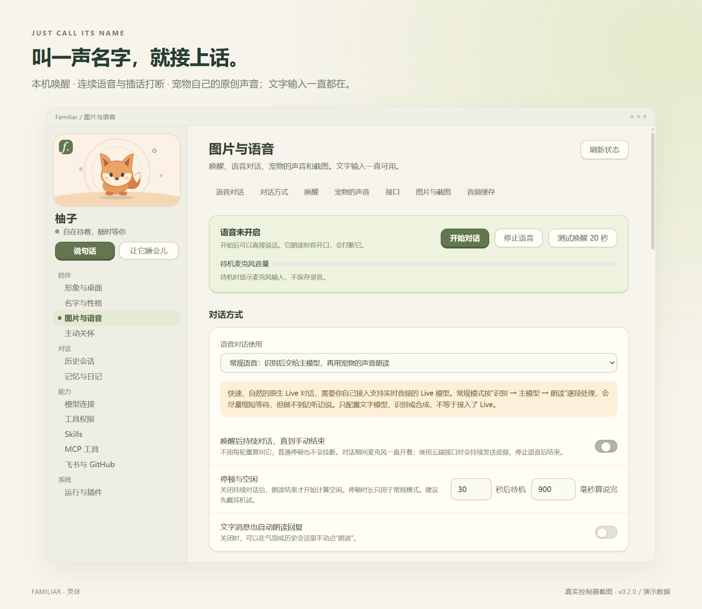
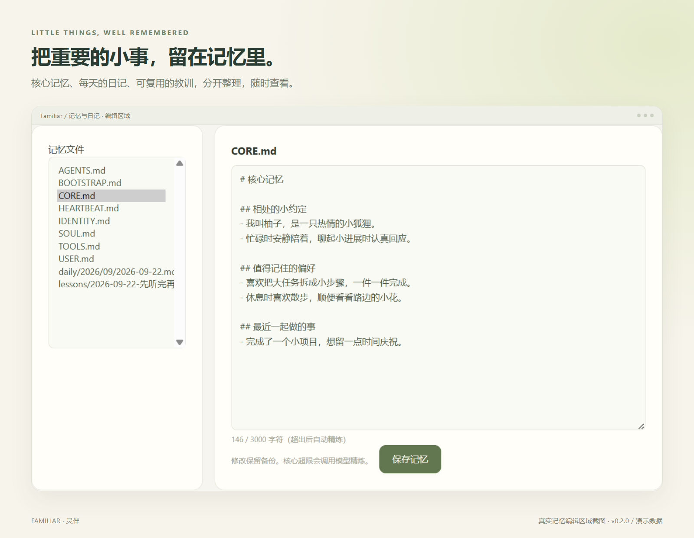
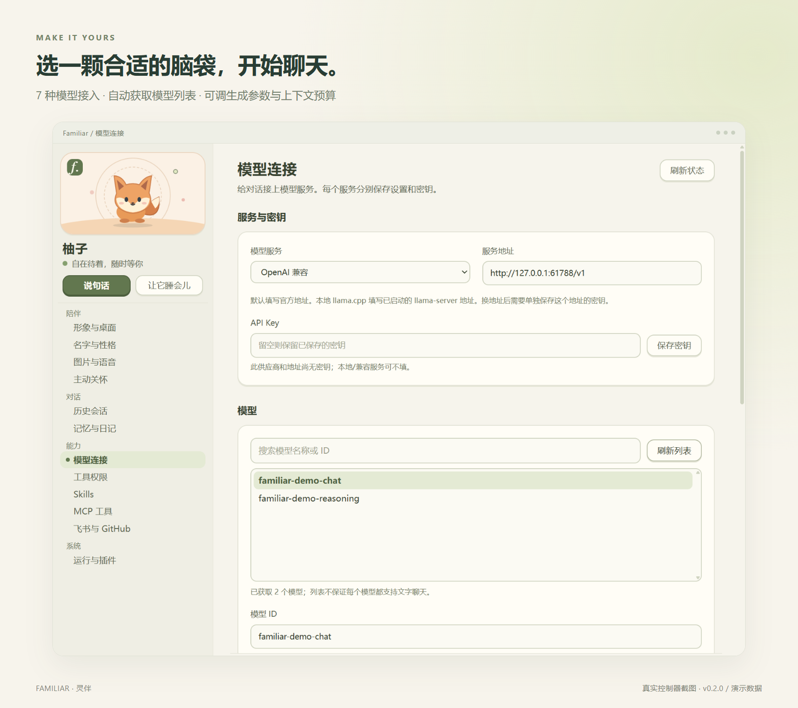
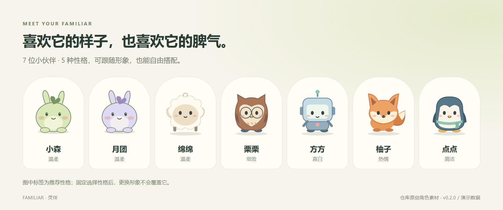

# Familiar · 灵伴



一个住在 Windows 桌面和 Android 手机上的小伙伴。点开宠物就能在气泡里连续聊天，也可以接入语音。选一个喜欢的形象和性格，连接你自己的模型，它会慢慢记住你们之间的约定和重要的小事。

[它能做什么](#它能做什么) · [下载使用](#下载使用) · [Android](#android) · [从源码运行](#从源码运行) · [控制器](#控制器) · [语音与图片](#语音与图片) · [记忆](#记忆) · [开发文档](docs/README.md)

> 图片是真实应用窗口，使用演示数据；外围背景和标题是展示排版。

## 它能做什么

| | |
| --- | --- |
| 头顶气泡聊天 | 双击宠物输入，回复在同一位置冒出来；控制器里能翻看和继续所有历史会话 |
| 七个原创形象、五种性格 | 形象和性格可以分开选；固定性格后，换形象不会改变它说话的方式 |
| 叫名字，用声音聊 | 本机识别名字唤醒，唤醒后持续对话；它说话时你开口就能打断；有自己的原创声音 |
| 看图、看文件 | 输入框里可以添加图片、PDF、Word，或者按需截一张屏 |
| 分层的记忆 | 核心规则随身带着；日记、教训和项目约定按需翻看，全是你能直接编辑的文件 |
| 工具与扩展 | 读写文件、执行命令、Skills、MCP、飞书、GitHub；全自动、有限执行、审批制度或全部拒绝由你决定 |
| 主动关怀 | 在合适的时候问候一句，或按你设定的时间提醒 |
| 自己选模型 | OpenAI 兼容、OpenAI、DeepSeek、Gemini、Claude、OpenRouter 和本地 llama.cpp |

## 下载使用

**v1.1.0 修复 Android 后台手机操作，新增 GitHub 更新提醒。** 从 [GitHub Releases](https://github.com/mengxingGG/My-Familiar/releases/tag/v1.1.0) 下载对应平台：

- [Windows x64 安装程序](https://github.com/mengxingGG/My-Familiar/releases/download/v1.1.0/Familiar-1.1.0-Setup-x64.exe)：安装后从开始菜单启动 Familiar。
- [Windows x64 免安装版](https://github.com/mengxingGG/My-Familiar/releases/download/v1.1.0/Familiar-1.1.0-win-x64.zip)：解压后运行 `Familiar.exe`，保留整个文件夹。
- [Android ARM64 APK](https://github.com/mengxingGG/My-Familiar/releases/download/v1.1.0/Familiar-1.1.0-arm64.apk)：支持 Android 9 及以上的 ARM64 设备，安装后打开 Familiar 配置模型。
- [SHA-256 校验和](https://github.com/mengxingGG/My-Familiar/releases/download/v1.1.0/SHA256SUMS.txt)。

发行包已包含运行环境，使用时不需要安装 Node.js 或开发 SDK。首次打开后在“模型连接”配置自己的模型和 API Key。Windows 双击宠物输入，Android 轻点完整宠物即可打开原生气泡输入。

Android 正式包使用独立发行签名，关闭调试；Windows 暂无 Authenticode 签名。完整变更、升级方法与验证范围见 [v1.1.0 发行说明](docs/releases/v1.1.0.md)。旧版本继续保留在 Releases。

1.0.0 请先手动安装本次更新。自 1.1.0 起，宠物和控制器会提醒 GitHub 新正式版，点击自动下载本机安装包，并验证完整性。Android 安装由系统确认；Windows 点击打开安装包所在位置。

## Android

Android 已接入项目的共享 Kernel、Provider、会话、记忆、Skills 和 Agent 工具。控制页与常驻宠物分别运行，关闭控制页后仍可在悬浮宠物的气泡里输入、流式接收回复和继续聊天。

- **常驻与气泡**：开启“小窝 → 常驻伙伴”，按系统页面允许悬浮窗和运行通知。奶油色回复与浅绿输入直接浮在桌面上，默认宠物在上、回复在中、输入在下；长回复内部滚动。使用设备自带输入法，回车直接发送，Shift＋回车换行，支持停止生成。
- **边角停靠**：可单独开启自动吸附和闲置收起。启用后停靠最近边缘，向外划动或闲置一段时间只露出半个小脑袋；轻点或向内拖展开，再点完整宠物聊天。
- **手机操作与权限**：在系统无障碍设置中启用“灵伴手机操作”。工具遵循全自动、有限执行、审批制度、全部拒绝四种模式；审批可添加精确白名单、允许一次、允许当前会话全部或拒绝。联网搜索、内部日记与记忆始终允许。目标变化或拒绝后不执行旧操作；受保护页面需手动交接。
- **日历与时钟**：日历支持本地日历管理、日程增删改查、全天/重复/单次安排、参会人、提醒、忙闲与私密级别。时钟接入标准闹钟、重复、铃声/振动、稍后提醒和倒计时；已有闹钟的完整读取、永久编辑/删除及计时器暂停等通过显示时钟后使用无障碍完成，按接收应用能力验证结果。外部笔记使用兼容应用入口，也可写灵伴本地笔记。
- **加密迁移**：“设置 → 数据迁移”提供密码保护的单文件导出、旧配置预览导入和恢复点；模型密钥可选，导入后重新存入新版 Keystore。
- **图片、文件与语音**：图片/PDF/Word 通过系统选择器导入，选择后仍须发送；识别、朗读和 Live 各自配置服务。麦克风授权后也不会自动录音。
- **连接与凭据**：支持 HTTP MCP、GitHub 接入和飞书私聊/办公，相关账号按需配置。模型密钥由 Android Keystore 加密，发行包不包含开发者或用户密钥。Android 暂不支持桌面的 stdio/npm MCP。

首次 Android 验收使用用户指定的模拟器，已用真实 DeepSeek 从原生气泡验证连续聊天、应用启动、无障碍观察/点击、日程写入及审批拒绝。模拟器通过 ARM64 转译运行；真 ARM 手机、HyperOS 后台策略、真实软键盘和长期功耗仍需设备验证。飞书、高德、GitHub 和云语音的账号业务应在配置后按需验证。详见 [Android 验收核对](docs/20_Familiar_Android验收核对.md)。

正式包包名为 `app.familiar.mobile`；先前开发包为 `app.familiar.mobile.debug`，二者可并存。旧版请先覆盖安装 [0.3.1 加密迁移版](https://github.com/mengxingGG/My-Familiar/releases/tag/v0.3.1-migration)，在设置中导出 `.familiar` 文件，再由正式版选择文件、输入密码、核对记忆冲突和模型地址后导入。迁移核心记忆、日记、教训、扩展记忆、模型连接及可选模型密钥、昵称/性格和宠物设置；聊天原文、附件、第三方登录和系统权限不在本次迁移范围。验证新版可用后再决定是否卸载旧版。详见 [迁移步骤](docs/releases/v0.3.1-migration.md)。

## 从源码运行

在 Windows 上安装 Node.js 24、npm 与 Windows 10/11 SDK（编译设备定位与本机语音组件需要），然后在项目根目录执行：

```powershell
npm ci
npm run build
npm start
```

单独打开控制器：

```powershell
npm run controller
```

也可以从宠物旁的“设置”或托盘菜单打开控制器。关闭控制器后，宠物继续运行；退出宠物用托盘菜单中的“退出 Familiar”，或控制器“运行与插件”里的“退出宠物”。

更新源码后，先退出宠物和控制器，再构建并重新启动两者，让后台与界面是同一版本，也释放本机唤醒组件。已有的设置、密钥、记忆和会话会继续保留。源码版默认把记忆放在项目根目录的 `.familiar/`，设置和会话放在 `%APPDATA%/Familiar`。

## 控制器



左侧小窗里住着当前的宠物，会跟着它的状态变化：思考时冒出小点，睡觉时飘出“z”，语音对话时有一圈光环；小窗的颜色随形象改变。下面按“陪伴、对话、能力、系统”分组列出所有设置页。

宠物需要你确认某个操作（例如执行命令、写入工作目录以外的文件）时，每一页顶部都会出现确认条，可以选只允许这一次、本会话内都允许，或加入白名单。形象、大小、置顶和气泡停留时间修改后立即生效并自动保存；其余页面用页面底部的保存按钮。

## 聊天



| 操作 | 用法 |
| --- | --- |
| 唤出输入 | 双击宠物、点“说句话”，或按 `Ctrl+Alt+Space` |
| 换行 / 发送 | `Enter` 换行；点“发送”或按 `Shift+Enter` 发送 |
| 收起输入 | `Esc`，未发送的草稿会保留 |
| 看回复 | 头顶气泡，长回复可以滚动，生成时可以停止；默认 15 秒后收起，可以在“形象与桌面”里修改 |
| 翻看旧对话 | 控制器“历史会话”，可以搜索、改名、删除，也能在这里接着聊（此时宠物不弹气泡） |
| 找回最近的回复 | 托盘菜单 |

对话很长时会自动整理旧内容：默认达到上下文窗口的 80% 时生成交接摘要，保留最近的原文，完整对话仍在历史会话里。详见[模型设置](docs/07_Familiar_LLM接入与会话缓存.md)和[日记与会话压缩](docs/11_Familiar_重要日记与会话压缩.md)。

## 语音与图片



**开始使用。** 打开控制器“图片与语音”，点“使用推荐配置”，再分别保存 OpenRouter 的识别和合成 Key。推荐配置是：Qwen3 ASR 识别、Fish S2.1 Pro 合成，并附带项目自己的原创参考声音，所以宠物在不同模型下也保持同一种声线。“试听原创声音”播放随程序附带的录音，不调用接口。

**怎么聊。**

- 喊宠物的名字唤醒（默认就是它的名字，也可以自定义多个唤醒词）。唤醒在本机识别，不上传待机音频。
- 唤醒后默认持续对话，不用每句都喊名字，直到你点“停止语音”；也可以关掉持续对话，改为空闲一段时间后回到待机。
- 它说话时你直接开口，它会停下来听。
- 输入框里的麦克风按钮是“语音转文字”：说完后文字进入输入框，改好再发送。
- 文字消息默认不自动朗读，可以在气泡里点“朗读”，或打开“文字消息也自动朗读回复”。

**实际速度。** 2026-10-11 用推荐配置和一个云端主模型实测：说完后约 3 秒识别出文字，约 13 秒宠物开口，其中主模型给出第一个字约 6 秒、合成第一段声音约 4 秒；插话后约 0.6 秒停下。识别结果与原文一致。这是一次样本，速度主要取决于主模型和网络。

**原生 Live。** 想要更快、边听边说的自然对话，需要你自己接入支持实时音频的 Live 模型和对应的 Key。目前可以配置 OpenAI `gpt-realtime` 或账户开放的 Gemini Live，但现在的适配仍会先等主模型回答，还不是原生 Live 的最快体验；使用 Live 时需选择服务商音色。路线和进度见 [Live 语音改造方案](docs/16_Familiar_Live语音改造调研与实施方案.md)。

**图片和文件。** 输入框可以添加图片、PDF、Word、文本，也可以粘贴图片。看图使用当前主模型，需选择支持图片的模型。打开“允许宠物在你提问时截图”后，它可以在需要时截取当前屏幕；再打开“提到屏幕、桌面或关卡时自动附图”，问到这些时会自动带上截图。手动截图只授权这一次，不会持续录屏。

叫名字没有反应时，在语音页看“待机麦克风音量”：一直为 0 通常是系统默认输入、静音或麦克风权限的问题。完整说明见[图片与语音用法](docs/14_Familiar_图片语音与宠物声音.md)。

## 记忆



| 记忆 | 放什么 | 什么时候用 |
| --- | --- | --- |
| 核心规则 `CORE.md` | 你要求它必须遵守的规则和长期偏好，最多 2000 字 | 每次对话都带着 |
| 教训 `lessons/主题.md` | 可以复用的经验，每条写成“规则 — 原因” | 按需读取 |
| 扩展记忆 `topics/主题.md` | 只适用于某个项目或某类事情的约定和资料 | 按需读取 |
| 日记 `daily/年/月/日期.md` | 值得回想的经历和进展，不抄录聊天 | 你问起过去的事时查找 |

教训和扩展记忆的文件开头都写着“何时读”，程序把它们汇总成一张索引放在核心规则后面，宠物就知道遇到什么事该去翻哪个文件。核心规则写满时不会自动压缩改写，而是请宠物先合并或删掉旧条目；偏好变了会原地改写，不留下互相矛盾的两条。

这些都是普通的 Markdown 文件，可以在“记忆与日记”里搜索、查看和编辑，修改前的版本会留作备份。设计说明见[记忆系统改造方案](docs/17_Familiar_记忆系统改造方案.md)。

## 模型连接

在“模型连接”中选择服务，填写服务地址并单独保存 API Key，就会自动获取模型列表；可以搜索选择，也可以直接填写模型 ID。按需设置温度、Top P、输出上限、思考强度或预算，保存后测试连接。每种服务分别保留设置，密钥按服务和地址分开、经系统加密保存。本地 llama.cpp 需要先自行启动 `llama-server`。

<details>
<summary>查看模型连接界面</summary>



图中的服务是本地演示程序，模型名称仅用于展示。

</details>

## 工具与扩展

宠物可以读写文件、执行命令、安装 Skill 和 MCP。默认读取、搜索和写入它自己的目录会直接执行；Shell、安装扩展和写入其他位置会先问你。在“工具权限”里可以按类别改成允许、先问或禁止，也能开启全自动，或撤销已记住的白名单。

- **Skills**：按需读取的方法说明，可以从本地目录、HTTPS 上的 SKILL.md 或直接粘贴安装；安装不会运行其中的脚本。
- **MCP 工具**：支持 HTTP、本地 stdio 和固定版本的 npm 包；已预置 Exa 搜索和高德地图，填好 Key 并启用即可。
- **飞书与 GitHub**：飞书可以扫码接入或使用已有机器人，开启办公工具和私聊；GitHub 支持浏览器登录或 Token，可以选只读。所需命令行工具在你点击后才安装到宠物目录。详见[飞书、GitHub 与角色性格](docs/10_Familiar_飞书GitHub与角色性格.md)。

## 日常陪伴



在“名字与性格”里给它起名字，选温柔、细致、直白、热情、简洁，或跟随形象推荐，也可以补充你喜欢的表达习惯。

“主动关怀”开启后，它会在合适的时候自然问候；你也可以添加每天定时的提醒。读取设备位置和用高德查询附近餐馆需要单独授权，未授权时只做普通问候，不会按 IP 猜你在哪里。“运行与插件”里可以设置登录 Windows 后自动启动宠物。详见[陪伴、权限与会话用法](docs/09_Familiar_日常陪伴与权限会话.md)。

## 数据与隐私

- 设置、会话和加密后的密钥在 `%APPDATA%/Familiar`；记忆、Skills 和工作目录在宠物之家（源码版是项目里的 `.familiar/`，安装版在 `%APPDATA%/Familiar/home`，免安装版在程序旁的 `.familiar/`）。
- API Key 用系统加密单独保存，不写进普通设置、日志或页面；语音接口的 Key 和主模型分开。
- 截图、录音都按次进行；录音默认只在内存中处理，不保存。
- 记忆检索和判断的诊断记录在 `%APPDATA%/Familiar/data/memory-trace-日期.json`，保留 30 天，可以直接删除。

备份或迁移时请保留整个 `%APPDATA%/Familiar` 和宠物之家，并在同一个 Windows 用户下恢复；加密密钥不能单独搬到别的电脑。

## 构建与检查

```powershell
npm run build              # 编译应用到 dist/
npm run check              # 类型检查、测试与构建
npm run smoke              # 真实窗口测试：双应用、气泡与输入（隔离数据、本地模拟模型）
npm run smoke:agent        # 记忆、Skill、MCP 和工具确认
npm run smoke:experience   # 即时设置、历史会话、审批、气泡计时与主动关怀
npm run smoke:integrations # 角色性格、飞书与 GitHub 设置、凭据与重启恢复
npm run smoke:context      # 会话压缩、摘要和历史原文保留
npm run smoke:voice        # 图片、语音设置、流式朗读、插话与随包试听
npm run smoke:wake         # 本机名字唤醒（离线语音样本）
```

用你已保存的 Key 做真实语音链路测试（会产生少量费用，并从扬声器播放）：

```powershell
node scripts/voice-live.mjs --saved-api
```

它只使用设置和密钥的隔离副本，测试语音由本机合成后注入，不打开真实麦克风；结果写入 `.artifacts/voice-live-时间戳/`。

生成本地便携运行目录，或构建 Windows x64 安装程序与免安装 ZIP（只在本地构建，不自动上传）：

```powershell
npm run package:dir
npm run package:release
```

便携目录入口是 `release/win-unpacked/Familiar.exe`，需要保留整个目录。首次安装依赖或打包需要下载 Electron。

## 文档

- [文档目录](docs/README.md)
- [继续开发与项目结构](docs/06_Familiar_继续开发指南.md)
- [插件实现、控制器与气泡交互](docs/04_Familiar_插件实现与气泡交互_v0.1.md)
- [验证记录](docs/05_Familiar_本地预览验收记录_v0.1.md)
- [记忆、Skill 与 MCP](docs/08_Familiar_记忆与Agent扩展.md) · [记忆系统改造方案](docs/17_Familiar_记忆系统改造方案.md)
- [图片、语音与宠物声音](docs/14_Familiar_图片语音与宠物声音.md) · [Live 语音改造方案](docs/16_Familiar_Live语音改造调研与实施方案.md)
- [飞书、GitHub 与角色性格](docs/10_Familiar_飞书GitHub与角色性格.md)
- [展示图片与重新拍摄](docs/12_Familiar_展示素材.md)
