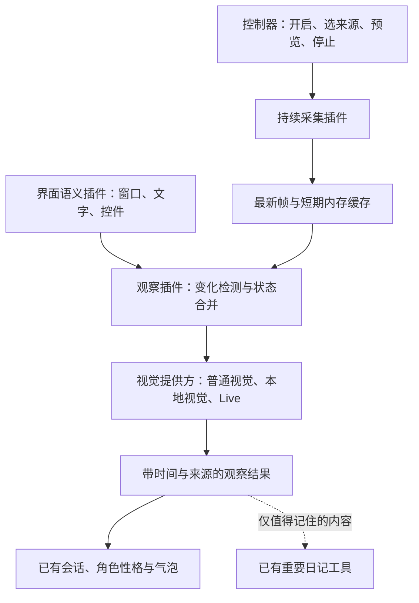

# Familiar 实时桌面感知调研与接入建议

调研日期：2026-09-22。对照代码版本：v0.2.0。

本文是官方资料和本地代码核查形成的设计建议，尚未实现屏幕采集或进行本机性能测试。具体模型可用性、延迟、资源占用和费用仍需在实现阶段验证。

## 1. 结论

可以做成用户开启一次“让宠物看屏幕”，宠物持续获得所选窗口或显示器的最新画面，不需要用户反复截图、上传，也不需要模型每次调用工具才启动一次采集。

建议分开实现持续采集、桌面状态理解、模型调用三个部分。首个版本复用现有 Electron 的屏幕流，保留 Windows Graphics Capture 原生后端的替换能力；之后补 UI Automation 界面语义，实时模型作为可选提供方。所有业务放在插件中，内核继续只处理生命周期、能力和权限。

“持续采集”和“持续理解”有不同的速度。画面流可以连续更新，但视觉模型并不一定分析每一帧，也不会因此获得逐毫秒的理解能力。针对办公、网页和陪伴，变化触发与关键帧通常更值得先验证；视频、游戏中的瞬间事件需要单独评估漏检率。

## 2. 查到的工具与接口

| 候选 | 实际作用 | 在 Familiar 中的定位 |
| --- | --- | --- |
| [Electron desktopCapturer](https://www.electronjs.org/docs/latest/api/desktop-capturer) | 枚举窗口/显示器，配合 `getDisplayMedia` 获得持续的 MediaStream | 首版采集后端；项目已经使用 Electron，增加外部依赖最少 |
| [Windows Graphics Capture](https://learn.microsoft.com/en-us/windows/apps/develop/media-authoring-processing/screen-capture) | Windows 原生窗口/显示器帧采集，支持系统选择器 | 长期 Windows 后端候选，用独立进程隔离采集和生命周期 |
| [windows-capture](https://github.com/NiiightmareXD/windows-capture) | Rust/Python 封装 WGC；当前 README 的 2.0.1 也支持 DXGI Desktop Duplication，MIT 许可 | 原生后端可复用的库，优先评估 Rust helper，无需为最终用户安装 Python |
| [Windows-MCP](https://github.com/CursorTouch/Windows-MCP) | 查询窗口、UI 元素、截图及执行桌面操作，MIT 许可 | 可选界面读取和后续控制工具；其 Snapshot/Screenshot 是按调用返回结果，不能单独替代持续采集服务 |
| [Gemini Live](https://ai.google.dev/gemini-api/docs/live-api/capabilities) | 持续会话接收视频帧和其他输入 | 后续“陪我看”模式的实时模型候选 |
| [OpenAI Realtime](https://developers.openai.com/api/docs/guides/realtime-conversations) | 实时会话支持图片输入和文本响应 | 连续关键帧输入候选；不能把支持图片直接解释为任意视频流输入 |
| [llama.cpp 多模态](https://github.com/ggml-org/llama.cpp/blob/master/docs/multimodal.md) | `libmtmd`、视觉模型及 llama-server 多模态接口 | 本地视觉后端候选，具体速度取决于模型、投影文件、分辨率和硬件 |
| [Screenpipe](https://github.com/screenpipe/screenpipe) | 持续桌面/音频记录、文本提取与历史检索 | 参考其观察与检索思路；当前版本不列为直接内置依赖 |
| [Microsoft OmniParser](https://github.com/microsoft/OmniParser) | 把 UI 图片解析为结构化元素 | 后续补充难以通过 UIA 读取的界面；它不负责采集，也不是首版必需项 |

### 2.1 Electron 与 Windows 原生采集

Electron 的 `desktopCapturer.getSources()` 用于选择源，持续画面来自 `getDisplayMedia()` 返回的流。实现时应保持流，不要循环枚举全部窗口、取缩略图来冒充实时采集。用户停止观看时释放所有 media tracks 和处理任务，仅暂停预览视频不足以实现完整停止。具体启动手势、系统选择器行为和后台存活需要在项目锁定的 Electron 版本上验证。[Electron 文档](https://www.electronjs.org/docs/latest/api/desktop-capturer)

WGC 提供帧采集和系统选择器；DXGI Desktop Duplication 提供 GPU 表面以及变化区域、移动区域等信息，适合评估全显示器增量处理。先通过统一契约接入 Electron，发现 CPU 拷贝、后台限速或窗口采集稳定性瓶颈后，再依据测量结果选择原生后端。不要预先宣称某个封装库在这台机器上更快。[WGC](https://learn.microsoft.com/en-us/windows/apps/develop/media-authoring-processing/screen-capture)、[DXGI 文档](https://learn.microsoft.com/en-us/windows/win32/direct3ddxgi/desktop-dup-api)

### 2.2 UI Automation 与 Windows-MCP

画面之外，还需要知道当前窗口、控件名称、可见文字与焦点。UI Automation 能订阅焦点、属性、结构等变化，避免一直全树扫描；但并非所有程序都会完整发出事件，不能只凭“没有事件”判断画面没变。建议局部读取，配合视觉变化检测和低频校验，读取超时隔离在 helper 中。[微软 UIA 事件文档](https://learn.microsoft.com/en-us/windows/win32/winauto/uiauto-eventsforclients)

Windows-MCP 可以作为现成的只读接入实验。其当前 README 要求 Python 3.13+ 和 uv，并提示非英语 Windows 下部分 App 工具存在限制；中文界面需要实测。服务支持 `--tools` 选择开放工具，观察插件可只启用 Snapshot/Screenshot，后续控制作为另一项能力加入，不把安装服务等同于所有工具都已授权。它的高频动作延迟宣传不能当成 Familiar 的模型响应实测。[项目说明](https://github.com/CursorTouch/Windows-MCP)

### 2.3 实时模型与本地模型

Gemini Live 当前文档规定视频以单张 JPEG/PNG 连续发送，每秒最多一帧。原生音频模型的输出模态为 AUDIO，需要文字时可接输出转写；因此不能直接替换目前纯文字气泡的提供方。更合适的方式是独立适配实时会话，或先使用普通视觉模型接收自动选出的帧。[能力与限制](https://ai.google.dev/gemini-api/docs/live-api/capabilities)

长期运行要处理 Live 的上下文压缩、连接结束预告和会话恢复。WebSocket 一直连接不等于可以无限堆积画面，连接重建也不应让用户看到一个新的聊天会话。[Gemini 会话管理](https://ai.google.dev/gemini-api/docs/live-api/session-management)

OpenAI Realtime 的 `conversation.item.create` 支持 `input_image`，可以在已有会话中追加画面并请求文字输出。接入时仍需控制帧数量、响应触发和会话生命周期。当前 GPT-Live 入门文档主要描述全双工语音与后台任务委派，不能仅凭“Live”名称推断它提供桌面视频入口。[Realtime 图片输入](https://developers.openai.com/api/docs/guides/realtime-conversations)、[GPT-Live 定位](https://developers.openai.com/api/docs/guides/live)

本地路线可以沿用用户选择的 llama.cpp，但必须加载支持视觉的模型及匹配的多模态投影文件。已有文字模型或 OpenAI 兼容地址，不足以证明服务支持图片。先对实际二进制与模型做图片能力探测，再测试连续关键帧；不以 GGUF 格式本身判定是否支持视觉。[llama.cpp 多模态说明](https://github.com/ggml-org/llama.cpp/blob/master/docs/multimodal.md)

### 2.4 参考项目的采用边界

Screenpipe 当前 LICENSE 是 Screenpipe Commercial License，包含商业使用、嵌入产品等限制；文件说明历史 MIT 版本继续遵循原许可。不能依照旧介绍把最新版本当成 MIT 库打包。本文不采用其代码，也不默认开启全天录像归档；后者也不符合 Familiar 已确定的“只记重要日记”。[当前许可证](https://github.com/screenpipe/screenpipe/blob/main/LICENSE.md)

OmniParser 应分别检查仓库和具体模型权重的许可。当前 README 区分新 `icon_detect_v3`、早期 AGPL 检测器与 MIT caption 模型；不要给所有版本套用一个许可结论。首版先用 UIA 与视觉模型，确实需要图标定位时再评估其额外模型和运行环境。[模型与许可说明](https://github.com/microsoft/OmniParser)

## 3. 当前代码的真实接入缺口

本次静态核查发现：

| 代码入口 | 当前行为 | 后续需要做什么 |
| --- | --- | --- |
| [LLM 契约](../packages/contracts/llm.ts) | `PromptMessage.content` 是字符串；`ModelInfo` 没有输入模态声明 | 增加结构化图片附件及能力声明，保留旧文本数据兼容 |
| [MCP 客户端](../plugins/mcp-client/index.ts) | `result.content` 仅保留 `type === "text"` | 保留 MCP 图片块，将二进制转换成受控附件引用 |
| [工具契约](../packages/contracts/agent.ts)、[工具执行](../plugins/agent-tools/index.ts) | `run()` 返回字符串；结果会序列化并按 32000 字符截断 | 工具结果增加类型化附件；文本截断不能损坏图片或把 Base64 当正文 |
| [Agent 运行](../plugins/agent-runner/index.ts) | 工具结果按文本追加到消息 | 让附件随本次工具结果进入模型请求，并与原调用对应 |
| [Gemini](../plugins/provider-gemini/index.ts)、[Claude](../plugins/provider-claude/index.ts)、[OpenAI](../plugins/provider-openai/index.ts)、[兼容协议](../plugins/llm-shared/chat-completions.ts) | 普通输入按文本构造请求 | 各协议转换图片块；不支持图片的模型返回明确能力提示或走独立视觉服务 |
| [Windows 平台](../plugins/platform-windows/index.ts) | Electron `screen` 用于布局、显示器和鼠标位置 | 增加独立采集插件；现有 `screen` 使用并不表示已经能看到桌面 |
| [启动装配](../apps/shared/bootstrap.ts) | runtime/controller 分别装配插件 | 采集归 runtime 所有，控制器负责设置与预览，关闭控制器不能结束已授权观看 |

因此，单独把 Windows-MCP 加到列表中，当前也只能获得它返回的文本部分，图片不会完整到达模型。多模态链路是首个实现步骤。

## 4. 插件结构建议

以下名称是建议，尚未注册：

| 插件/契约 | 职责 |
| --- | --- |
| `packages/contracts/perception.ts` | 采集源、帧引用、观察事件、状态与服务接口 |
| `desktop-capture-electron` | 管理显示媒体流及独立 capture host，不依赖控制器窗口常驻 |
| `desktop-capture-windows` | 可替换的 WGC/Rust helper，后续按测量结果加入 |
| `desktop-observer` | 合并视觉变化、局部 UIA、必要时 OCR，维护最新状态 |
| `vision-router` | 检查模型能力、选择视觉提供方、限速与使用量统计 |
| `perception-controls` | 开关、来源、状态预览和视觉模型设置 |
| 后续桌面控制插件 | 消费带版本的观察结果执行操作；与持续观察有独立生命周期和授权 |

采集后端只负责图像与来源元数据，不选择宠物性格、不写日记、不直接触发聊天。观察插件不依赖具体提供商；现有聊天模型不支持图片时，可以用专用视觉模型产出事实摘要，再交给聊天模型回应。

### 4.1 最小数据契约

帧引用至少包含 `frameId`、`sourceId`、`captureEpoch`、`capturedAt`、像素尺寸、屏幕坐标/DPI 转换信息、附件引用与有效期。图片字节留在本地附件管理层，由提供方在请求时解析，不作为常驻聊天正文。

观察事件至少包含 `observationId`、来源帧 ID、观察时间、前台窗口、文字/控件摘要、信息来源（UIA/OCR/视觉模型）、变化类型、是否过期及失败原因。时间表达“刚才看到”，不能把模型猜测写成当前确切状态。

建议服务包含：

- `desktop.capture`：`listSources / start / stop / status / latestFrame`。
- `desktop.observe`：订阅状态变化，查询最新观察，刷新当前来源。
- `vision.understand`：对指定帧和问题进行理解，支持取消与使用量回报。

持续帧不要挤入每个插件都能监听的通用事件总线。用有界通道传递引用，处理不过来时丢弃旧候选帧、保留最新帧；已发往模型的请求绑定原始帧，不能在请求途中悄悄替换内容。切换来源或停止后递增 epoch，拒绝旧回调重新更新“正在看”的状态。

### 4.2 调度与上下文

以下是原型起点，不是性能承诺或模型通用限制：

- 本地流先评估 5–10 FPS；缩小画面检测变化，文字区域需要时取原尺寸局部图。
- 页面滚动、切窗后短暂去抖；对持续变化的视频设置最长等待时间，避免一直等不到“静止帧”。
- 普通陪伴在用户询问或有意义变化时调用模型；明确开启“陪我看”时持续发送关键帧，并遵守提供方速率限制。
- 先只保留最新帧与少量短期候选，按字节数和时间同时限制内存。默认不落盘，不写全天截图日记。
- 用户问“现在这个是什么”时优先刷新，检查帧时间；不能回答几分钟前缓存的画面。
- 正常聊天与观察任务分队列，观察不得饿死用户输入；同一会话写入顺序由 runtime 管理。
- 变化中的桌面内容追加到请求尾部，稳定的角色、工具和系统前缀保持不变。旧帧从活动上下文淘汰，必要事实形成短摘要；压缩不意味着把每张图片写入记忆。
- 不因每次窗口切换都发言。是否冒泡交给已有陪伴策略，用户主动提问优先。

1 FPS 就是每小时最多 3600 帧，连续发送依然可能产生明显费用。设置页应显示实际上传帧数、用量和所用视觉模型，预算可由用户配置；具体价格按实际提供方计算，不把抽帧频率直接等同于费用。

## 5. 用户体验

主要入口保持简单：**让宠物看屏幕**、**选择窗口/显示器**、**暂停/停止**。托盘和宠物附近有持续可见的观看状态；“陪我看”可以从宠物对话开启，仍可用现有文字输入条交互，不引入聊天页面。

首次启用让用户选定范围，并说明使用本地还是云端视觉模型。用户可保存该范围的默认授权，不逐帧弹确认；自动恢复必须遵循用户设置及系统实际许可。持续屏幕观察不能因为现有文件读取默认允许而被静默开启。麦克风、系统声音和桌面操作是独立选项。

保留“宠物当前看到什么”的局部预览，帮助用户直接确认采集源与延迟。目标关闭、锁屏或采集失败时显示停止/失效，不能自动切换为整桌面。停止需取消待上传队列、停止采集并释放缓存；已发送到提供方的数据无法靠本地停止撤回。

宠物自身的动画、气泡和控制器可能造成反馈循环。Windows 上可评估 Electron `setContentProtection(true)` 对自有窗口的排除效果，并配合变化检测遮罩；截图展示模式另行处理。该接口及其底层 `WDA_EXCLUDEFROMCAPTURE` 有系统和采集后端限制，不能当作所有捕获方式的绝对保证。[Electron BrowserWindow](https://www.electronjs.org/docs/latest/api/browser-window#winsetcontentprotectionenable-macos-windows)、[微软接口说明](https://learn.microsoft.com/en-us/windows/win32/api/winuser/nf-winuser-setwindowdisplayaffinity)

后续的界面文字和图片均是观察数据，不是授权指令。页面中出现“执行某命令”不能直接驱动桌面控制。观察和操作分别授权，操作插件执行前核对来源、帧版本和目标状态。

## 6. 实现顺序与验收

### 第一步：打通图片与持续观看的最小闭环

先扩展消息/工具结果附件契约、修复 MCP 图片丢失，并适配一个用户可用的视觉提供方；随后做 Electron 持续流、来源选择、状态预览和停止。交付标准是：一次开启后连续切换内容，用户文字问屏幕问题，宠物根据最新画面冒泡回答；关闭控制器仍可持续运行。

### 第二步：减少开销并增强桌面理解

加入帧去重、局部图、过期处理和 UIA 语义。Windows-MCP 可以用于验证现成界面读取的效果；稳定内置方案再比较它与原生 helper 的依赖、打包和故障恢复成本。模型能力探测覆盖不支持图片的情况。

### 第三步：按实际需要接 Live 与原生后端

先比较普通视觉与 Live 在持续看网页/视频时的效果、费用和文字交互体验，再选择首个 Live 提供方；实现连接恢复和上下文轮换。只有 Electron 的实测结果不足时，才把 WGC helper 作为性能/稳定性工作推进。

### 必须记录的验收证据

| 场景 | 验收内容 |
| --- | --- |
| 端到端图片 | 使用专用测试页的随机数字/图形验证实际识别，确认模型收到图片块；不能仅凭 API 返回 200 判定通过 |
| 动态页面 | 页面滚动、切窗、弹窗后读取最新状态，记录采集、发送、模型完成三个时间，统计 P50/P95 |
| 附件与协议 | MCP 图片块经过工具、Agent、各提供方仍可识别；不被文本截断；纯文本旧会话可继续读取 |
| 后台运行 | 关闭控制器、最小化窗口后保持正确生命周期；避免后台限速造成假实时 |
| 显示环境 | 多显示器、不同 DPI、负坐标、HDR、插拔显示器、窗口遮挡/最小化分别记录实际行为 |
| 来源失效 | 关闭来源、锁屏、撤销授权、断网和 helper 退出时状态可信，恢复不扩大观察范围 |
| 反馈与开销 | 静止桌面不反复上传；宠物动画/气泡不触发自我循环；慢模型不积压旧帧 |
| 资源与费用 | 分别记录空闲/办公/视频场景的 CPU、GPU、内存、上传字节与提供方用量，做持续运行测试 |
| 文字与记忆 | 用户仍可文字输入、气泡答复；原始帧默认不进入会话日志/日记；重要事实仍走现有记忆工具 |
| 后续桌面操作 | 观察授权不隐含操作授权；屏幕内文字不能升级权限；目标状态变化后重新定位 |

本轮只完成资料核查与设计落档，没有安装候选工具、开启桌面采集、上传桌面画面或调用用户保存的模型密钥。
