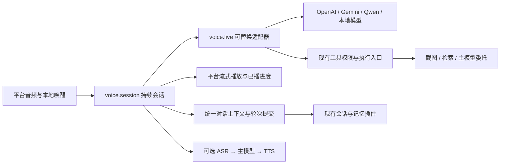

# Familiar Live 语音改造调研与实施方案

日期：2026-10-11。状态：**V0 与 V1 部分代码已落地，原生 Live 直接回答仍待实施**；实际交付见第 10 节，不代表新 Live 通路通过实机验收。

目标是改善响应速度、识别准确率和自然交流，支持唤醒后持续对话。方案评估原生 Live 与现有链式语音，语音、会话和记忆通过公共契约协作。

调研分为云端实时协议与开源双向语音两条线。以下区分代码现状、公开能力、工程建议和未验证项；模型接入前应重新核对官方支持范围，当前语音实现见文档 14。

## 1. 结论与取舍

建议将 **Live 原生对话**作为自然语音交流的重点通路，保留现有链式语音作为可选模式。

| 路线 | 如何回答 | 主要收益 | 必须接受的约束 |
| --- | --- | --- | --- |
| Live 原生对话（拟新增路由） | 持续上传音频，实时模型直接理解并生成声音；需要外部事实或操作时调用 Familiar 工具 | 减少串行往返，利用语调和持续上下文，更适合插话与连续交流 | 普通语音回答由所选 Live 模型生成；不能同时保证每句话都由任意文字主模型回答 |
| 主模型代理 Live（当前实现） | Live 调用 `ask_familiar` → 等主模型完整结果 → Live 朗读 | 复用当前主模型、记忆与工具 | 多一次模型接力，工具结果目前非增量；更换传输不会消除这段等待 |
| 识别 → 主模型 → TTS（保留） | 转写后主模型生成，分句合成，PCM 到达即播 | 主模型自由选择，现有原创声音可继续使用 | 当前识别等待停顿后整句上传；VAD、转写、推理、合成延迟累加 |

**Live 不是给录音接口换个名字，也不只意味着 WebSocket。** 双向传输、边生成边播放、播放时能接收用户声音、模型原生同时听说，是不同能力，必须分别声明和验证。

实现建议：先让当前协议跑通可观察的 Live 原生闭环，再加入 Qwen Omni Realtime；本地原生双向路线优先评估 MiniCPM-o。接入顺序不替用户选择默认模型，也不将 Familiar 绑定到特定厂商。

### 用户接入前提与推荐模型

**原生 Live 需要支持实时音频的模型**，包括可用模型 ID、匹配端点、账户权限及对应凭据。仅配置文字主模型、ASR、TTS 或普通音频接口，不满足这一前提。

常规模式仍按“识别 → 主模型 → 朗读”逐段处理，不能提供同等低延迟的原生 Live 同时听说体验。开发将在现有插件和用户设备允许的范围内优化采集交接、判句、流式播放、识别提示与取消；不宣称换一个开关即可消除模型和网络等待。即使接入 Live，实际速度仍受服务、网络与当前代理链路影响。

| 推荐模型（2026-10-11 核对） | 适用与接入说明 | 当前 Familiar 状态 |
| --- | --- | --- |
| `gpt-realtime` | [OpenAI 正式实时模型](https://developers.openai.com/api/docs/models/gpt-realtime)，使用 OpenAI Realtime 端点及独立 Key | 可填入配置；当前仍通过主模型代理，真实通话待验收 |
| `gemini-3.8-live` | [Gemini 官方 Live 示例模型](https://ai.google.dev/gemini-api/docs/live-api/session-management)，需账户实际开放该模型；可改填账户可用的 Live 型号 | 可填入配置；当前仍通过主模型代理，真实通话待验收 |
| `qwen3.8-omni-flash-realtime` | [Qwen Omni 实时模型](https://www.alibabacloud.com/help/en/model-studio/realtime)，适合重点评估中文与注册音色；需正确地域、工作空间与协议 | 后续适配候选，界面不提供可用配置按钮；不能当 OpenAI 兼容地址直接替换 |
| `openbmb/MiniCPM-o-4_5` | [本地双向模型候选](https://github.com/OpenBMB/MiniCPM-o)，需另行部署推理服务并评估设备资源 | 未部署、未适配；不是安装 Familiar 即可离线使用 |

界面推荐只是显式填写草稿，不自动切模式、换声、保存 Key 或发起付费通话。OpenAI/Gemini 当前适配尚不能使用项目参考声，需用户主动选择服务商音色；其它模型不凭名称推断兼容性。能力不足时明确提示，禁止自动退回常规模式却继续显示为 Live。

## 2. 当前代码中已经确认的缺口

以下保留最初调研时的源码缺口，不是端到端性能实测；本次已处理的持续模式、部分唤醒交接及采集块调整见第 10 节。

| 位置 | 当前行为 | 对改造的影响 |
| --- | --- | --- |
| `plugins/voice-session/live.ts` | 系统指令要求每句话调用 `ask_familiar`；OpenAI 设置 `tool_choice: required` | Live 模型没有直接交流通路；这是额外串行延迟的明确来源，具体耗时待埋点 |
| 同上，工具结果回传 | `callbacks.ask()` 返回完整字符串后才提交工具结果并请求朗读 | 不能把主模型的流式文字生成等同于 Live 已经流式接力 |
| `plugins/voice-session/index.ts` | 播放完成后默认 30 秒空闲即结束，再回待机唤醒 | 应补独立“持续对话”策略，满足用户一次唤醒后继续聊的要求 |
| `plugins/voice-windows/Speech.cs` | 唤醒只发送命中的名字，未传交接音频 | “小森，帮我看看……”可能只留下“小森”；需解决名字后第一句话的交接 |
| `voice-session/index.ts` 的 `start()` | 把唤醒名字发给主模型或 Live | 名字应触发进入会话，不应默认成为一轮昂贵的业务问答 |
| `plugins/voice-session/ui/capture.js` | 约 100ms 聚合一块音频；Host 输出 24kHz PCM | 可比较 20–40ms，但必须同时检查桥接开销与背压，不能只调小数值 |
| `live.ts` | OpenAI/Gemini 均使用约 800ms 静音判句 | 应按供应商能力选择语义/声学端点检测，分别评估停顿与抢话 |
| `live.ts` 与音频 Host | 清播放队列和取消生成，但没有向 OpenAI 回传实际已播放位置进行截断 | 服务端可能把用户没听到的回答当成已说过 |
| `live.ts` | Gemini `goAway` 导致报错退出，未管理恢复句柄 | 需要重连与会话恢复策略，不能只让用户重新唤醒 |
| `LiveCallbacks` | 没有统一的用户/助手转录、轮次与播放进度事件 | 直接回答前须补统一历史入口，避免 Live 变成记忆系统之外的另一份对话 |

已有可复用部分：独立 `voice-api` / `voice-session` / `voice-windows` 插件、凭据留在 Runtime、音频采集的 AEC 请求、PCM 流式播放、取消与 epoch 隔离、现有主模型和工具权限边界。浏览器接受 AEC 参数不等于扬声器回声已经通过验收。

## 3. 云端 Live：资料支持什么

### OpenAI Realtime

官方支持原生语音对话、函数调用、WebRTC/WebSocket 和语义 VAD。普通交流可以直接生成声音；没有协议要求每轮必须先调用文字主模型。WebSocket 播放由客户端管理，打断时应停止本地声音，并用 `conversation.item.truncate` 和已播放毫秒数截断未听到的内容。[Realtime conversations](https://developers.openai.com/api/docs/guides/realtime-conversations)

Familiar 用法建议：保留现有适配基础，新增明确的原生回答模式；函数调用只服务于确实需要的外部能力。模型、音色与 VAD 的具体支持随端点验证；不能把 OpenAI GA 消息直接发给所有自称“兼容”的服务。

### Gemini Live

官方支持持续音频输入、音频输出、转录、VAD 和工具交互。原生输入为 16kHz、输出为 24kHz；输入可用 MIME 声明其它采样率供服务端重采样，因此现有声明 24kHz 的输入不能仅凭采样率判为错误。[Capabilities](https://ai.google.dev/gemini-api/docs/live-api/capabilities)

官方建议小块持续发送并管理播放缓冲。长会话需区分上下文压缩和连接恢复：保存 `SessionResumptionUpdate` 中有效句柄，处理 `goAway` 后的恢复；生成结束也不等于音频播放完毕。[Best practices](https://ai.google.dev/gemini-api/docs/live-api/best-practices)、[Session management](https://ai.google.dev/gemini-api/docs/live-api/session-management)

Familiar 用法建议：在统一会话状态机之下实现 Gemini 的恢复适配；字幕用于展示与可确认历史，不把转录文本假定为模型音频理解的精确中间过程。恢复时不重放已经执行的工具。

### Qwen Omni Realtime

官方已有实时音频通路、打断、函数调用等能力，但具体模型的协议字段、输入格式、地域端点和功能组合不同。它应有独立适配器，不能通过改 OpenAI `baseUrl` 冒充完成兼容。[Qwen Omni Realtime](https://www.alibabacloud.com/help/en/model-studio/realtime)

**固定宠物声线与 Live 并非必然冲突。** 官方 Omni 声音克隆流程支持先用 `qwen-voice-enrollment` 注册参考音频，再把返回的音色 ID 用于相匹配的 Omni 模型。注册时的 `target_model` 必须与调用模型一致；这不是把现有 Fish 的参考音频字段原样发过去。[Voice cloning](https://help.aliyun.com/en/model-studio/qwen-omni-voice-cloning)

Familiar 用法建议：将参考音频作为声音档案的源资产，将注册后的音色 ID 作为“服务商、地域/端点、目标模型、参考摘要”下的映射。换模型先核对能力与映射，再决定是否注册；不能静默换预设声音。此处尚未注册音色、调用付费服务或测量声音相似度。

## 4. 开源项目：借鉴什么

| 项目与一手来源 | 有价值的设计 | Familiar 的采用边界 |
| --- | --- | --- |
| [MiniCPM-o](https://github.com/OpenBMB/MiniCPM-o) | 原生音频双向交互，中英文语音和参考音色 | 最值得验证的本地模型候选；参考能力来自官方说明，尚未在当前设备跑通 |
| [MiniCPM-o Demo](https://github.com/OpenBMB/MiniCPM-o-Demo) 与 [Duplex 架构](https://openbmb.github.io/MiniCPM-o-Demo/site/en/architecture/duplex.html) | 网关、会话和推理 Worker 分层；连续输入时由模型决定听或说 | 原生双向 Worker 会在会话期间占用资源；示例快速部署说明要求 Linux 和大显存 GPU，不能据模型有 GGUF 就认定手机能完整运行双向链路 |
| [Moshi](https://github.com/kyutai-labs/moshi) | 真正同时听说的模型框架、流式音频编解码、Rust 推理实现 | 学习时序、持续流和资源管理；官方说明 Windows 不属正式支持范围，中文适用性仍需专项评估，不作为当前默认引擎 |
| [Pipecat interruptions](https://docs.pipecat.ai/pipecat/fundamentals/interruptions) | 打断优先穿过处理链，取消生成/合成、清除未播放声音，并保留已发生的工具结果 | 借鉴控制事件和取消传播；无需把现有 TypeScript 插件系统整体换成 Python 服务 |
| [LiveKit turn handling](https://docs.livekit.io/agents/logic/turns/tuning/) | 分离说话开始、句子结束、用户插话和误打断恢复 | 借鉴策略和观测方法；需要房间/WebRTC 传输时再评估 SDK，不先引入整套服务基础设施 |

代码、模型权重、模型附件的许可分别核对；选定具体版本后再记录采用清单。项目作者的设备指标和演示效果不当作 Familiar 实测结果。

## 5. 保留插件架构的目标设计

下图中的新能力名是设计草案，尚未注册为现有服务。

- **Kernel 不变**：不加入供应商、音频或记忆业务。Tauri 原生插件负责设备/系统桥接，Familiar 插件负责业务策略。
- **平台音频**：采集、正确重采样、回声处理、播放、硬件时间与权限。定义 PCM 格式和实际播放进度；不把 DOM、Electron 句柄或 Node WebSocket 泄漏到共享契约。
- **`voice.session`**：拥有通话生命周期、唤醒交接、连接/听/说状态、取消代次与恢复策略；连接状态与输入/输出状态分开，允许“我在说，同时仍在听”。
- **拟议 `voice.live`**：声明输入/输出格式、工具、转录、原生双向、语义 VAD、声音注册、恢复和截断等能力。按模型/端点核实，不能只看厂商名。工具、音频、转录事件携带 session/turn/response 身份和顺序。
- **传输适配**：WebSocket/WebRTC 与模型能力分离；桌面可复用当前 WS，移动端按宿主能力选择。WebRTC 有媒体传输优势，但不替代工具授权、正确的上下文和实际设备 AEC 验证。长期密钥不进入 WebView。
- **链式通路**：继续提供用户任意主模型与原创 TTS 声线组合；切换模式时显式说明由谁生成答案、使用哪种声音，不覆盖原配置。

## 6. 唤醒后的电话式体验

1. 待机时本地识别唤醒词；开启语音权限和服务配置后，命中词进入 Live 连接与持续采集。显示可区分的“连接中 / 正在听 / 正在说 / 重连中 / 已静音”。
2. 唤醒交接应保留短时内存预录音，覆盖“名字 + 第一条请求”；要确定 helper 与会话共用采集流，或携带有限长度的音频交接。丢弃重复区间，保留采样率/时间标记，不能靠 SAPI 通配结果恢复原话。
3. 连续模式不在每轮后重新要求唤醒，不因普通思考停顿或默认 30 秒空闲自动挂断。设置可选“空闲回待机”，已有配置迁移需显式处理。
4. 支持手动挂断、静音和本地会话结束意图；“结束语音”由本地会话控制并立即停止传输，不能等待模型同意。引用、否定句中的同名词不直接当挂断命令，规则需测试。
5. 用户插话先处理声音与生成的取消，再处理新轮次；误把咳嗽、键盘或简短附和当插话的情况单独评估。持续对话不意味着无条件抢话，也不意味着持续上传桌面视频。
6. 断网明确进入恢复状态，限制恢复时长和缓冲上限；恢复失败退出并提示。停止、权限撤销、插件卸载要到达设备与连接所有者，晚到回调不能重新开麦或播放。

持续会话期间音频何时发送、静音后是否仍连接、恢复是否丢失刚才一段话都需可见。待机音频默认不落盘；服务商有使用时长限制或计费行为时在配置处准确说明。

## 7. 与记忆改造会话的接口边界

本方案不修改 `memory-files`、会话压缩或日记策略；以下是待双方落实的公共接口语义，不是已存在的 API。

| 边界 | 最小语义 | 关键约束 |
| --- | --- | --- |
| 会话上下文快照 | 角色、人设、当前会话摘要、最近已提交轮次、必要记忆、版本和预算 | 不读取整份记忆库拼接音频提示；快照作为数据，不将检索内容提升为系统命令 |
| 轮次提交 | `sessionId`、`turnId`、来源 Live、用户文本状态、助手文本状态、响应 ID、打断/失败标记 | 唯一对话写入者；去重提交；部分转录不逐字进入长期记忆 |
| 播放确认 | 已播放的响应/内容段、毫秒范围、完成或打断 | “已生成”与“用户已听到”分开；无精确字音对齐时不伪造完整已听转录 |
| 工具执行 | 请求 ID、会话身份、工具名、经校验的参数、授权、取消、结构化结果 | 复用现有权限和确认入口；不给 Live 暴露可绕过授权的直连 MCP 或文件入口 |
| 主模型委托 | 需要深度处理时传递明确任务与已授权上下文，返回结构化结果 | 不能重新把所有普通交流强制绕回主模型；主模型忙于文字轮次时排队/提示，不抢占用户请求 |
| 上下文更新与恢复 | 快照版本、已提交轮次游标、已执行工具 ID、可恢复状态 | 会话恢复不是重复执行；说话打断不等于已完成外部操作被撤销 |

原生 Live 开放直接回答前，先接通统一历史与上下文。否则用户会遇到“声音伙伴不知道刚才文字聊过什么”，新记忆系统也会漏收 Live 轮次。字幕缺失或不稳定的供应商应声明限制，不能悄悄编造逐字稿。

## 8. 实施顺序与完成条件

| 阶段 | 交付 | 完成条件 |
| --- | --- | --- |
| V0 基线与契约 | 时间点记录、录音夹具、能力表、对话/记忆交接协议 | 复现现有等待与交接缺口；确定数据唯一写入者；不先改默认声音 |
| V1 可运行 Live 闭环 | 在当前适配基础上做显式原生回答模式、持续会话、转录提交、唤醒交接、取消与已播同步 | 实机完成一次唤醒后 20 轮交流，能打断、静音、挂断；文本历史与已听内容一致 |
| V2 Provider 完整性 | OpenAI 截断、Gemini 恢复、Qwen 独立协议与音色注册映射 | 本地协议夹具和真实服务分别通过；断线无重复工具执行；固定声音策略可核查 |
| V3 本地双向候选 | MiniCPM-o 单独适配与资源测量 | 先在适用硬件上通过中文、延迟、插话、音色与长会话测试，再评估成为默认选项 |
| V4 多平台 | 对齐文档 15 的 Tauri 平台音频与生命周期能力 | Android 前台先验证；后台通话另按原生资源所有者和设备限制验收，不将隐藏 WebView 当后台能力 |

V1 在与记忆改造并行时只通过约定契约交接，避免两组会话同时改同一模块。音频协议、会话策略、供应商、UI 可以独立实现，不把新功能全部继续堆入 `voice-session/index.ts`。

## 9. 如何验证速度、准确率和自然程度

**延迟分别记账**：唤醒→采集就绪、用户真实说完→端点判断、端点→首音频到达、首音频到达→实际播放、用户插话→实际静音。总延迟从真实说完开始算，不能从服务端已经判句后才开始计时。首块音频到达不能当作已播放。

每个候选使用相同的至少 30 条中文录音、相同网络与设备，区分首次连接与已连接，统计 p50/p95、超时和失败率；调用工具与普通交流分开。初步工程目标为已连接普通问答“说完到开口”p50 ≤ 1.2s、p95 ≤ 2.5s，插话到静音 p95 ≤ 250ms；**这些是待评估目标，不是当前成绩，也不是供应商承诺。** 同时记录模型/版本、采样参数、成本、CPU/GPU/内存和扬声器/耳机条件。

准确率不能只看能否转出一句话：覆盖宠物名字、数字日期、中文夹英文、否定、同音词、轻声、口音、远场、背景电视、长短停顿与连续自我纠正。转写用中文字符错误率和关键字段正确率；原生音频理解另测任务是否正确及是否误调用工具。Live 本身不保证识别更准。

必须覆盖的行为：

- 一句“名字 + 请求”不丢首句；仅喊名字不开启重复模型问答；连续 20 轮无需再次唤醒。
- 耳机和扬声器分别验证回声、自唤醒、边播边听、半句停顿、咳嗽/附和和插话后恢复。
- 已生成但没播放的回答不作为已听事实；中断后的迟到音频、工具回调和字幕不污染下一轮。
- 工具等待期间插话，已完成操作仍留记录；断线/重连/重复事件不重复执行外部操作。
- 至少 30 分钟会话观察缓冲、连接恢复与资源增长；挂断/卸载后麦克风、连接和播放全部释放。
- 默认配置迁移、模式切换和声音能力不匹配均有明确行为；离线、无 Key、麦克风拒绝仍可使用文字。

本地夹具覆盖事件顺序、取消、恢复、采样率与背压；Electron/Tauri 的设备测试证明实际播放和释放；真实供应商测试证明协议与网络表现。三者各有范围，不能相互替代。

## 10. 实现状态

当前保留主模型代理 Live 与链式语音，原生模型直接回答、完整轮次同步和自动恢复仍按 V1/V2 推进。本文方案不代表真实 Live 通话或所有声音能力已经验证。

### 已实现的基础能力

- `voice.api` 提供配置就绪检查和模型推荐元数据，设置页显示 Live 接入前提、常规模式体验上限、当前代理路由与候选未适配状态。缺模型、官方接口 Key 或支持的声音身份时，在开麦与联网前阻止开始，不自动切换模式。
- 增加 `continuous` 设置，默认为开启；缺该字段的旧配置迁移为持续对话，已显式设为 `false` 则保留空闲退出。设置页能直接关闭，原 `idleSeconds` 保留且仅在关闭持续模式后生效。
- 名字本身只进入监听。Windows 适配器可将含前后文的已识别音频片段（最多 8 秒）从内存转换为通用 PCM 交给语音会话；常规模式转写后只去掉明确的句首名字和纯唤醒问候，再提交请求。
- 此交接覆盖识别器已经捕获的片段，**不是单一采集流的无缝预录音**。识别器返回纯名字、音频不可用、超过 8 秒或麦克风切换间隙仍需继续说；不同设备的交接完整性未验收。
- 采集聚合从约 100ms 调整为约 40ms，桥接积压按最多约 1 秒 PCM 字节数限制；未据此宣称总延迟已达标。ASR 增加可选语言和名字/专有词提示，留空时保持旧请求形态，不强制不支持参数的接口接受。
- 不增加 Kernel 业务、不改记忆/日记实现、不引入模型下载或新运行依赖；保留主模型代理 Live。原生直接回答、统一 Live 轮次、已播截断、自动恢复、静音与本地挂断意图仍按 V1/V2 继续实现，当前使用手动结束语音按钮。

验证方法见 [本地开发与回归测试](05_Familiar_本地预览验收记录_v0.1.md)。协议、回放、实际音频设备与真实供应商通话应分别检查。

继续开发先读本方案、文档 14、文档 15 和宪法第 100–106 条，再补齐 V0/V1 尚未完成部分。旧文档中“主模型增量桥接”的方向仅适用于代理模式，不能再次变成全部 Live 对话的强制链路。具体型号和接口上线前重新核对官方支持清单。
