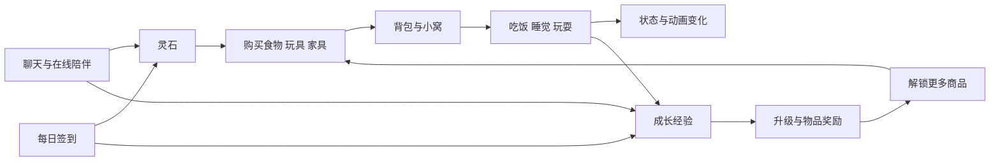

# Familiar 灵伴 2.0.0 养成与房间方案

日期：2026-11-02。目标平台：Windows、Android。状态：**已进入 2.0.0 实施，核心与双端界面已接入**。交付内容、实际规则与验证结果见 [实施与验收记录](25_Familiar_2.0.0实施与验收.md)。

2.0.0 为灵伴增加可持续的日常生活：陪伴与聊天获得灵石，照料和日常活动积累经验，用食物、玩具和家具改善宠物生活，并自由布置主控页面的小窝。养成影响宠物的外观与日常动作，聊天、推理、语音、记忆和工具执行能力保持独立。

本文保留产品设计基线。用户授权开工后，价格、经验、等级、衰减速度、离线规则和首发内容数量作为首版默认值落地，仍可通过后续使用反馈调整；与实际实现有差异的范围以实施记录为准。角色和家具制作范围见 [2.0.0 角色动画与家具美术方案](24_Familiar_2.0.0角色动画与家具美术方案.md)。

## 1. 已确认需求

| 模块 | 需求 |
| --- | --- |
| 宠物需求 | 增加吃饭、睡觉、玩耍需求，并通过动作表现 |
| 自动照料 | 自动吃背包中的基础食物；手动喂食和玩耍增加互动 |
| 灵石 | 和宠物聊天、在线陪伴时产生，作为简单货币购买食物、玩具、床和家具 |
| 背包 | 存放食物、灵石、玩具及已购未放置家具 |
| 签到 | 每天签到一次，获得少量灵石 |
| 小窝 | 主控页面引入房间，支持动态、自由布置 |
| 家具 | 多种箱庭风格，按套装设计、按单品出售，可混搭 |
| 定价 | 食物偏低、玩具中等、家具偏高 |
| 长期缺粮 | 背包长期缺少食物时，宠物逐渐虚弱、颓废，主要体现为桌面形象变化，对实际工作无影响 |
| 现有角色 | 为七个现有形象补充、完善动画 |
| 新增角色 | DeepSeek Q 版鲸鱼娘、GPT Q 版、Claude Q 版及相应动画 |
| 鲸鱼娘造型 | 蓝发、鲸尾；端饭碗用于吃饭动画，饭碗不作为常驻造型 |
| 成长等级 | 根据成长与日常活动积累经验，升级解锁更高级的食物、家具等物品，并提供物品奖励 |

## 2. 版本定位与日常循环

建议将 2.0.0 定位为“有日常生活的小伙伴”。用户可以只让它陪着工作，也可以主动照料、收集家具、布置房间。缺少昂贵物品时仍能吃饭、休息、玩耍。

建议首版仍是一位伙伴拥有一套需求、背包、钱包、等级和房间；更换外观沿用这些状态，不变成十只需要分别照料的宠物。形象、性格、模型连接分别选择，选用 DeepSeek 外观不会自动切换 Provider，也不会覆盖用户的性格设置。

## 3. 需求、自动照料与表现状态

### 3.1 三项需求

以下为建议初值，数值范围均为 0–100；越高越好。界面优先用“吃饱了”“有点困”“想玩一会儿”等短语表达，可展开查看数值。

| 需求 | 自然变化建议 | 满足方式 | 外观反馈 |
| --- | --- | --- | --- |
| 饱食 | 每小时减少 3 点 | 饱食低于 40 时自动吃基础口粮；手动选择其他食物 | 吃饭、满足、摸肚子、饥饿待机 |
| 精力 | 清醒时每小时减少 4 点 | 低于 30 时自行休息；睡眠每小时恢复 12 点，达到 90 后醒来；可手动安排小睡 | 打哈欠、趴下、呼吸、伸懒腰 |
| 心情 | 缺少娱乐时每小时减少 1 点 | 手动玩耍、轻互动；已放置玩具可触发自主玩耍 | 开心、玩玩具、发呆、无聊 |

自动进食只从被允许自动食用的库存扣除。基础口粮默认允许，特殊食物默认保留供手动使用。可调整食物优先级；饱食已满时不消耗物品。自动照料不自行花灵石购买食物。

建议放置玩具后每 6 小时最多自主玩一次，恢复 15 点心情；手动玩耍恢复 20 点，恢复效果间隔至少 30 分钟。间隔内仍可播放互动动作，但不重复发经验。基础招手、摸头、徒手小游戏免费可用。

没有床也能在初始软垫上休息。已购买但留在背包的床不参与房间行为；放好后才成为睡觉位置。高价床主要增加外观、姿势和收集价值，基础软垫提供足够的精力恢复。

### 3.2 缺粮与虚弱

建议把短时需求和长期虚弱分开：精力低表现为困倦，心情低表现为无聊；只有持续吃不饱且没有可自动食用库存，才累积“缺粮时长”。背包刚好吃空但宠物仍饱腹时，不立即变虚弱。

| 建议阶段 | 连续缺粮条件 | 桌面与小窝中的表现 |
| --- | --- | --- |
| 普通饥饿 | 饱食低于 20、无可自动食用库存，累计不足 12 小时 | 偶尔摸肚子、看向食盆 |
| 没精神 | 上述状态累计 12–36 小时 | 眼睛半睁、动作幅度减小、耳朵或尾巴略垂 |
| 虚弱 | 累计 36–72 小时 | 坐着或趴着的时间增加、反应动作放缓 |
| 颓废 | 累计达到 72 小时 | 无力待机、抱膝或蜷卧；保持可点击、可对话 |

各阈值是待调参建议。虚弱有上限，不死亡、不离家、不损坏物品，也不扣等级或已获得经验。用户工作时不反复弹窗催喂。

恢复以真正吃到食物为准，单纯购买或打开背包不算恢复。建议第一顿有效进食就缓解最严重的表情，后续正常进食、休息和玩耍逐步恢复；以半天内可明显恢复为调参目标。精确恢复曲线在需求模块讨论时确定。

“没有食物”和“只有未允许自动食用的特殊食物”要分别显示，后者提供直接喂食入口。库存提示和虚弱状态不会更改模型参数、上下文预算、权限、输出质量或工具速度。

### 3.3 后台与离线

后台仍在运行、界面不可见、系统休眠和进程已结束应分别处理。需求按已记录时间补算，不依赖房间页面一直开着；后台已经处理过的时间不能再次结算。

建议离线需求补算最多覆盖最近 72 小时，超出的时间作为休养期冻结；在线和离线采用同一进食阈值，按时间顺序处理衰减、吃饭、睡眠和库存耗尽。例：离开时有口粮，应先模拟正常吃饭，耗尽且饱食降低后才开始累计缺粮，不能直接按离开时长判为颓废。

离线不产生在线灵石，不补领签到，不追发往日经验。重回应用只展示简短的生活摘要，不连播全部错过的动画。72 小时上限属于建议，需与实际回访体验一起确认。

## 4. 灵石、商店与签到

### 4.1 建议获取规则

| 来源 | 建议收益 | 每日上限 | 计入条件 |
| --- | --- | --- | --- |
| 每日签到 | 10 灵石 | 1 次 | 主动点击领取，同一养成档案当天只能成功一次 |
| 在线陪伴 | 每 15 分钟 2 灵石 | 48 灵石 | 宠物 Runtime 在运行且设备处于可用的非休眠、非锁屏状态；各窗口共用计时 |
| 聊天 | 每个有效轮次 2 灵石 | 20 灵石 | 用户主动发起的对话完成；同一轮的重试、工具调用和分段回复只记一次 |

“在线”指本机有效陪伴，不要求使用云端模型。断网时的本地模型聊天和有效陪伴同样适用。无需检查用户在其他应用输入的内容。

建议聊天计奖最短间隔 60 秒，短时间重复内容不重复计奖；语音按完整对话轮次计算，不按识别碎片计算。系统主动消息、导入历史、失败或取消的轮次不计入；普通交流不按字数或 token 消耗高低计价。

Android 息屏、被系统挂起或回收的时间不当作在线；两端沿用相同规则和上限。后台策略差异需通过实际设备验证。

签到建议使用养成档案的固定时区和自然日，首次按设备时区建立。每次成功记录日期与领取事件；跨午夜、多窗口点击、重启和时区切换不能重复领取同一日。单机产品保留基本的时间回拨检查，不宣称能完全防止本地修改存档。

### 4.2 建议价格和生活成本

| 类别 | 建议单价 | 示例与用途 |
| --- | --- | --- |
| 基础食物 | 4 灵石 | 基础口粮，恢复约 40 饱食；默认自动食用 |
| 其他食物 | 6–12 灵石 | 果盘、便当、甜点；更多恢复量或特别的进食表现 |
| 玩具 | 30–80 灵石 | 小球、积木、纸风车；永久拥有、可重复使用 |
| 家具 | 80–280 灵石 | 床、桌椅、柜子、灯、地毯；按单品购买 |

床归入家具；特殊食物不成为基本生存条件。高级食物不会按价格倍增经验，家具不提高聊天奖励或工作能力。

以每天签到、在线 2 小时、完成 5 个计奖聊天轮次为例：收入为 `10 + 16 + 10 = 36` 灵石。按每天预算两份基础口粮计算，支出 8，净积累约 28。40 灵石的玩具约需 2 天，180 灵石的床约需 7 天，780 灵石的暖木套装约需 28 天；均为从零积攒、未计赠品和升级奖励的估算。饱食衰减 72 点/日对应平均 1.8 份口粮，按两份估算留有余量。

每日签到足以覆盖建议基础口粮成本。建议新档案赠送 80 灵石、8 份口粮、食盆和软垫，让第一次打开就有完整照料能力；这组赠送数值也需讨论确认。

灵石以整数记账，背包的钱包页与主页面显示同一余额。购买成功后扣款与入库同时完成；失败不扣款，余额不足不生成订单。记录获取、购买和奖励流水，动画播放失败不能重复消费。

## 5. 经验、等级与解锁

### 5.1 成长来源

等级表达陪伴积累。建议经验由规则直接计算，用户能看到本次来自哪项日常；模型不评判用户聊得是否“足够好”，也不拥有直接修改经验或灵石的权限。

| 日常 | 建议经验 | 每日限制 |
| --- | --- | --- |
| 签到 | 10 | 一次，与签到领取共用事件 |
| 有效进食 | 10 | 首次真正恢复饱食时；自动和手动合并计数 |
| 充分休息 | 10 | 首次累计有效睡眠达到 30 分钟 |
| 玩耍 | 10 | 首次完成有效玩耍；自主与手动合并计数 |
| 聊天 | 每个计奖轮次 2 | 最多 20，与灵石采用相同轮次去重 |
| 在线成长 | 每 30 分钟 5 | 最多 30，与有效陪伴计时共用来源 |

建议单日最多 90 经验；上述 2 小时、5 轮聊天且完成照料的示例约为 70 经验。高级食物与昂贵玩具不会提高同一日常的经验奖励，反复投喂和重放动画不能刷经验。

### 5.2 等级节奏与奖励

建议首发等级为 1–20。当前等级为 L 时，升下一级需要 `60 + 20 × (L - 1)` 经验。满级后保留累计经验供后续扩展。按每日约 70 经验估算，达到 5 / 8 / 12 / 20 级分别需要约 6 / 12 / 26 / 66 天，暂不计算额外活动。

建议每升一级自动赠送 10 灵石和 1 份基础口粮，关键等级另赠指定物品。所有奖励直接进入背包，获得弹窗只负责展示；恢复页面或跳过动画不会再次发奖。

| 等级 | 商店解锁建议 | 里程碑赠品建议 |
| --- | --- | --- |
| 1 | 基础口粮、普通玩具、暖木家具 | 新档案初始物品 |
| 3 | 果盘与便当、进阶玩具 | 小球 1 个 |
| 5 | 苔光森林家具 | 叶片椅 1 件 |
| 8 | 月湾海居家具 | 浪纹地毯 1 件 |
| 12 | 星灯书房家具、精致甜点 | 星灯 1 件 |
| 20 | 成长纪念摆件的展示资格 | 成长纪念摆件 1 件 |

“解锁”表示可以购买，“奖励”表示已经获得，界面要使用不同提示。跨过多个等级时逐项结算未发奖励；重启、重连和导入同一存档都不能重复发放。

基础口粮、休息软垫、免费轻互动始终可用。饥饿、未签到、长时间离开不扣等级或经验。更换角色不会重置等级；房间装饰和高级物品不改变工作能力。

## 6. 背包、房间和家具

### 6.1 背包规则

背包分为“食物、玩具、家具、钱包”。食物按种类堆叠，默认无保质期；玩具、家具具有独立实例，同款可以拥有多件。建议不设需要付费扩容的格子限制。

未放置物品显示在可用库存，已放置物品显示房间位置并可收回。同一实例只能存在于背包或房间其中一处；“购买后立即布置”也遵守此规则。收回家具不销毁、不重复扣费。取消布置恢复原位或原库存。

玩具同时支持拿出来互动和放在房间中自主使用。初始食盆与软垫属于基础物品；饥饿时可从任何食物详情直接喂食，不要求先切到固定页面。

### 6.2 房间交互建议

建议采用固定视角的 2.5D 箱庭：墙面、地板与物件具有统一透视，角色保持 2D 动画。延续当前奶油色、鼠尾草绿和柔和轮廓。视角与美术最终稿仍待讨论。

普通模式下，点击宠物聊天，点击食盆喂食，点击床安排休息，点击玩具互动。“布置”进入编辑模式，明确区分拖家具和点击宠物。

| 编辑能力 | 建议行为 |
| --- | --- |
| 自由移动 | 家具可在合法地面或墙面区域拖动；轻量吸附可关闭 |
| 转向 | 提供素材支持的朝向；无对应素材时不显示无效旋转按钮 |
| 遮挡 | 以落地点决定前后关系，桌面、柜顶等可放物件使用明确放置面 |
| 动态反馈 | 拖动时显示占地、合法位置和遮挡；非法位置不会保存 |
| 收回 | 已放置家具回到背包，保留实例与拥有关系 |
| 撤销与保存 | 编辑会话可撤销；保存后提交完整布局，取消恢复进入时布局 |
| 可达性 | 床和玩具保留可交互位置；挪动正在使用的物件时安全结束动作 |
| 窄屏操作 | Android 支持拖动，也提供选中后移动、转向、收回的按钮 |

宠物可以在房间里的可达位置小范围移动，走向床、食盆和玩具。房间主视图与桌面宠物使用同一状态；两个表面同时可见也不会生成两份消耗或收益。角色和重要入口不能被家具完全遮住，编辑模式可直接选中被遮挡物件。

建议首发四套六件家具，共 24 件，另有初始食盆、软垫和 20 级纪念摆件。四套分别为暖木小居、苔光森林、月湾海居、星灯书房；具体单品、价格与互动见 [美术方案](24_Familiar_2.0.0角色动画与家具美术方案.md)。套装可整套预览，每件独立购买，已拥有数量始终可见。

### 6.3 主控页面布局

Windows 首页建议改为“小窝”：房间占主要区域，旁边展示三项需求和等级进度，顶部显示灵石及签到，底部提供喂食、玩耍、休息、背包、商店、布置入口。现有聊天、能力和设置仍可直接进入，待审批工作保持醒目。

Android 沿用现有“小窝 / 聊天 / 能力 / 设置”导航。小窝顶部放等级与钱包，中部是房间，下方是需求和操作；背包、商店、布置使用适合触摸的面板。悬浮宠物以角色动画为主，需要完整布置时打开小窝。

## 7. 两端共用规则与数据边界

当前仓库基线为 `package.json` 1.1.0；Windows 使用 Electron，Android 使用 Tauri 与独立 Runtime。现有角色资源位于 `characters/`，七个角色各有六类动作、每类两帧，清单帧率为 1。当前 `PetAction` 只有 `idle/greet/drag/think/sleep/happy`，移动角色 ID 也有固定列表；新增角色与动作需要更新相应契约和实际渲染入口。

以下为候选职责划分，不代表已经存在这些插件或接口：

| 职责 | 建议所有者 |
| --- | --- |
| 需求、时间结算、生活事件 | 共享养成业务插件 |
| 钱包、商品、购买、背包、奖励账本 | 共享物品与经济业务插件；通过统一事务边界处理跨域变更 |
| 经验、等级、解锁 | 共享成长业务插件或养成插件的独立模块 |
| 房间布局与交互点 | 房间业务及表现插件 |
| 外观、表情、动作资源与降级 | Character 与 Renderer |
| 时间、进程存活、存储、原生表面 | Windows / Android 平台适配 |

遵守 [开发宪法](02_Familiar_开发宪法_v0.1.md)：业务不进入 Kernel，共享规则不依赖 Electron、Tauri、Node 或 DOM。具体拆成几个插件在模块讨论后决定，先保证完整闭环。

每个养成档案只有一个 Runtime 写入者。UI 提交购买、使用、签到和保存布局命令，接收版本化快照；同一消费、奖励和领取事件具有稳定身份并只提交一次。钱包、库存、需求、经验、等级奖励和布局的关联变更必须能一致恢复，不能各自写成功一半。

存档需记录版本、档案身份、需求与结算时间、钱包和流水、库存实例、房间布局、签到日、累计经验、已发等级奖励。升级增加新数据时保留原有聊天、记忆、配置与凭据；迁移前建立可恢复备份，旧版读取不支持的新格式时明确提示。

建议 2.0.0 先共用规则和数据格式，各设备维护各自养成档案。**跨设备实时同步尚未确认**；导出导入不能被描述为实时同步，也不能简单叠加两端余额或重复领取等级奖励。

### 7.1 开发文档与执行规范

开发按已有规范推进，本文不覆盖开发宪法或放宽现有边界。进入每个模块前按以下顺序核对文档与实际契约：

1. [开发宪法](02_Familiar_开发宪法_v0.1.md) → [多平台改造方案](15_Familiar_Tauri多平台改造方案.md) → [继续开发指南](06_Familiar_继续开发指南.md)。
2. [插件与交互边界](04_Familiar_插件实现与气泡交互_v0.1.md)，以及该模块当前的能力提供者、消费者和版本化契约。
3. Android 同时核对 [平台分层](18_Familiar_Android开工与系统能力方案.md)、[常驻生命周期](19_Familiar_Android常驻运行实施.md)、[移动界面规范](android-ui/BRIEF.md) 与 [产品桥接线](android-ui/INTEGRATION.md)。
4. 验证依照 [回归测试](05_Familiar_本地预览验收记录_v0.1.md) 与 [Android 测试矩阵](20_Familiar_Android验收核对.md)，业务变更运行 `npm run check`，再按受影响范围做实际界面或设备验证。

新功能优先插件化，UI 不直接写钱包、背包或成长数据，超时不自动重放购买与领奖。后台任务由对应 Runtime 或原生资源所有者管理，页面卸载清理监听和动画，不依赖 WebView 定时器证明后台可用。

每个阶段保持软件可运行，协议变更同步文档，需求确认、候选方案、已实现和已验收分别标注。验收使用隔离数据；纯文档修改只做文档检查，模拟器结果不替代真机验证。

## 8. 实施顺序与验收

| 阶段 | 可运行交付 | 必须验证 |
| --- | --- | --- |
| A 规则与视觉讨论 | 确定需求曲线、经济、等级、房间视角及角色定稿 | 区分用户需求、建议数值与最终决定 |
| B 首个养成闭环 | 单角色吃饭、睡眠、玩耍、背包、签到和灵石；成长经验与首个等级奖励 | 重启后状态保留；消费和奖励不重复；虚弱不影响真实聊天与工具 |
| C 小窝与商店 | 暖木一套、购买与收回、自由布置、等级解锁 | 两端购买、拖动、取消和保存；库存与布局一致 |
| D 动画与内容扩展 | 七个原角色动画升级、三个新增角色、全部首发家具和食物 | 每个角色完整动作矩阵；道具、朝向、睡床遮挡和小尺寸辨识 |
| E 双平台验收 | Windows 完整回归、Android 模拟器回归及真机观察 | 后台、息屏、回收恢复、迁移、长时间资源占用与实际设备功耗 |

关键场景：

- 同一日连续签到、多窗口同时点击、重启后再点，只领取一次。
- 同一聊天重试、取消、工具多轮和语音分段不会重复发收益或经验。
- 背包口粮自动扣除，特殊食物保留；缺粮分阶段表现，补粮后恢复。
- 饥饿、虚弱、睡眠三种外观下，完成相同聊天和工具任务，权限、结果及取消行为正常。
- 升级只授予一次奖励；商店正确区分未解锁、可购买、已拥有、已放置。
- 更换全部十个形象，需求、钱包、经验和房间不重置；模型和性格设置保持用户选择。
- 正常退出、强退、后台回收、跨午夜、休眠和时间回拨后，状态不重复结算，灵石不为负。
- 拖动正在使用的床或玩具、取消编辑、重复保存、购买后立即放置，库存仍一致。
- 1.1.0 升级后旧数据完整，养成初始化只发生一次。

现已完成共享 `pet-life` 插件、协议、双端界面、十角色动画和四套家具接入。Windows 真实 Runtime/控制器/发行目录、移动端浏览器交互、Google Android 15 模拟器原生与签名包启动均已通过；用户雷电 Android 14 实例的核心启动未通过，真机矩阵尚未覆盖，详见实施记录。
